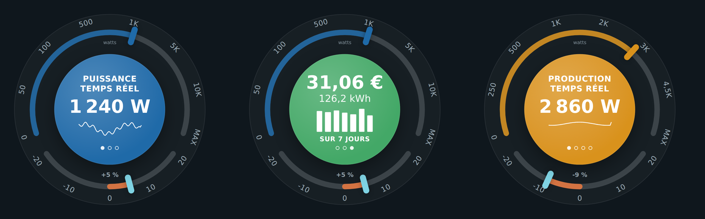
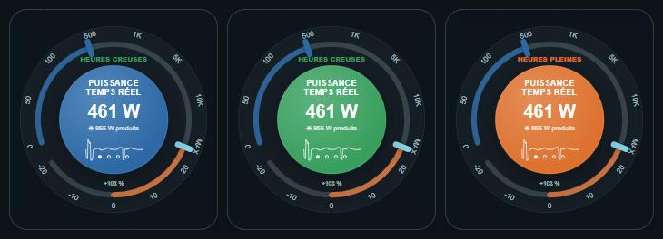
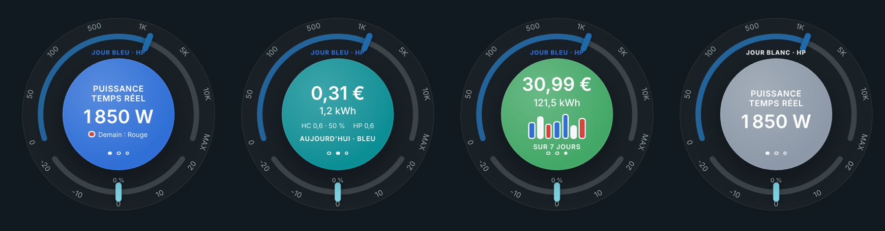

# ⚡ HOLM Ecojoko Card

[](https://hacs.xyz/)


[🇫🇷 Français](README.md) · 🇬🇧 English

**The famous consumption dial, in Home Assistant: live power, today's cost, the week, and whether you're using more or less than usual.**

HOLM Ecojoko Card takes the spirit of the Ecojoko dial: a large power gauge with a logarithmic scale, a central disc that cycles through several pieces of information, and a small gauge showing whether **you're using more or less than usual today**. It works with any meter (Ecojoko, Linky, clamp meter…) and also has a **solar production mode**.

> ✨ **No helper.** Today's and the week's figures come from Home Assistant statistics. Everything is set in the visual editor.

### At a glance

- 🎯 **Real-time power** on a 0 → 10 kW gauge (adjustable scale), with the last hour's curve.
- 💶 **Today**: kWh and cost, with your off-peak / peak prices (numbers or entities), and the off-peak share.
- 🌗 **Off-peak / peak hours**: “Off-peak hours” or “Peak hours” on the dial, and/or a green / orange disc — automatic with [HOLM HP/HC](https://github.com/kaaribou/holm-tarif), or based on which off-peak / peak counter is increasing.
- 🔵⚪🔴 **Tempo option (EDF, France)**: the 6 indexes (Blue, White, Red × off-peak / peak) and their prices, “Blue day · Off-peak” on the dial, disc in the day's colour, tomorrow's colour, and weekly bars coloured by day.
- 🔢 **Any counter**: sensors reset every day (Ecojoko…) or **cumulative indexes** (Linky, ZLinky…), detected automatically — no daily sub-meter needed.
- 📊 **Last 7 days**: cost, kWh and daily bars.
- ↕️ **Today's difference**: compared with the average of the last 7 days **at the same hours** (+5%, −9%…).
- ☀️ **Solar production mode**: live, daily and weekly production and self-consumption, with valuation (self-consumed price / feed-in price).
- 🔄 Automatic (or manual) cycling, custom colours, adjustable size.
- 🌍 **8 languages**: English, French, German, Spanish, Italian, Dutch, Portuguese and Polish.



*Screenshots in French — the card follows the language of your Home Assistant profile.*

### 🆕 What's new in 1.4.0

- 🌍 **The card speaks 8 languages**: English, French, German, Spanish, Italian, Dutch, Portuguese and Polish, editor included. It follows the language of your Home Assistant profile (English if your language isn't translated yet); the `language` option lets you force one. Numbers and dates follow the language too.

**Off-peak / peak hours**: text only, text and background in off-peak hours, text and background in peak hours



**Tempo option**: Blue day with tomorrow's colour, today's cost, week in Tempo colours, White day



---

## Installation

### With HACS (recommended)

1. HACS → ⋮ menu → **Custom repositories**.
2. Add `https://github.com/kaaribou/holm-ecojoko-card`, category **Dashboard** (*Plugin*).
3. Search for the card → **Download**.
4. Reload the page (Ctrl + F5).

### Manually

1. Copy `dist/holm-ecojoko-card.js` to `config/www/community/holm-ecojoko-card/`.
2. **Settings → Dashboards → ⋮ → Resources → Add**: `/local/community/holm-ecojoko-card/holm-ecojoko-card.js`, type **JavaScript module**.
3. Reload the page.

---

## Usage

```yaml
type: custom:holm-ecojoko-card
power: sensor.house_power               # W, real time
energy_hc: sensor.energy_off_peak       # kWh (or Wh), total_increasing
energy_hp: sensor.energy_peak
price_hc: 0.2068                        # or an entity (input_number…)
price_hp: 0.27
```

**Cumulative indexes (Linky, ZLinky…)**: set your off-peak and peak indexes directly. The card computes today's consumption (current value − value at midnight, read from Home Assistant statistics): no need to create daily counters (*utility_meter*).

```yaml
type: custom:holm-ecojoko-card
power: sensor.linky_apparent_power
energy_hc: sensor.lixee_easf01          # off-peak index (Wh or kWh)
energy_hp: sensor.lixee_easf02          # peak index
energy_counter: total                   # optional: detected automatically
price_hc: 0.2068
price_hp: 0.27
```

**Solar production mode:**

```yaml
type: custom:holm-ecojoko-card
mode: solar
power: sensor.solar_power
energy: sensor.solar_production         # kWh
export_energy: sensor.exported_energy   # kWh (optional)
price_self: 0.2516                      # value of a self-consumed kWh
price_export: 0.04                      # feed-in price
```

## Options

| Option | Description | Default |
|---|---|---|
| `mode` | `conso` (consumption) or `solar` (production) | `conso` |
| `language` | Card language: `fr`, `en`, `de`, `es`, `it`, `nl`, `pt`, `pl` | the profile's |
| `power` | Real-time power, in W (**required**) | — |
| `energy_hc` / `energy_hp` | Energy used in off-peak / peak hours (kWh or Wh): daily counter or cumulative index | — |
| `hc_display` | Off-peak / peak indicator: `text` (text on the dial), `color` (green / orange disc), `both`, `none` | `text` |
| `hc_pages` | Coloured background on the `power` page only or on `all` pages | `power` |
| `hc_source` | Entity telling off-peak hours (e.g. `binary_sensor.heures_creuses`, the Linky's current tariff) | automatic |
| `hc_values` | Values of `hc_source` meaning “off-peak” | `on, HC, HC.., heures creuses` |
| `energy_counter` | `auto`, `daily` (reset every day) or `total` (cumulative index) | `auto` |
| `price_hc` / `price_hp` | Off-peak / peak kWh price: number or entity | — |
| `tariff` | Tariff: `hchp` (off-peak / peak) or `tempo` | `hchp` |
| `energy_bleu_hc` … `energy_rouge_hp` | Tempo: the 6 indexes (`bleu`, `blanc`, `rouge` × `hc`, `hp`) | — |
| `price_bleu_hc` … `price_rouge_hp` | Tempo: the 6 prices (number or entity) | — |
| `tempo_color` / `tempo_color_tomorrow` | Tempo: today's and tomorrow's colour | automatic |
| `solar_power` / `solar_energy` / `export_energy` | In consumption mode: adds a “solar” page | — |
| `energy` / `price_self` / `price_export` / `forecast` | Solar mode: production (kWh), kWh values, forecast | — |
| `max_power` | Gauge maximum power (W) | `12000` (6000 in solar mode) |
| `scale` | Gauge scale marks | `0, 50, 100, 500, 1000, 5000, 10000` |
| `rotate_seconds` | Auto-rotation (0 = off) | `10` |
| `title` / `title_position` | Title, at the top or bottom | — |
| `size` / `show_frame` | Dial size, card frame | — |
| `colors` | Colours of each page (`power`, `today`, `week`, `solar`…), `hc` / `hp` for the indicator, `bleu` / `blanc` / `rouge` for Tempo | blue / turquoise / green / gold, green / orange |

### Off-peak / peak hours

The card knows whether you're in off-peak hours, with no setup:

1. with the **[HOLM HP/HC](https://github.com/kaaribou/holm-tarif)** integration, its `binary_sensor.heures_creuses` sensor is found automatically;
2. otherwise, from your `energy_hc` / `energy_hp` counters: the one increasing tells the current period (the indicator appears at the first increase);
3. or from the entity of your choice (`hc_source`), for example the current tariff given by your Linky meter.

The indicator can show “Off-peak hours” / “Peak hours” on the dial, colour the disc green / orange (on the power page or on all pages), or both.

### Tempo option

For EDF's **Tempo** option (France), choose **Tariff → Tempo** in the editor, then set your 6 indexes (a Linky or ZLinky provides them) and your 6 prices.

```yaml
type: custom:holm-ecojoko-card
power: sensor.linky_sinsts
tariff: tempo
energy_bleu_hc: sensor.linky_easf01
energy_bleu_hp: sensor.linky_easf02
energy_blanc_hc: sensor.linky_easf03
energy_blanc_hp: sensor.linky_easf04
energy_rouge_hc: sensor.linky_easf05
energy_rouge_hp: sensor.linky_easf06
price_bleu_hc: 0.1296
price_bleu_hp: 0.1609
price_blanc_hc: 0.1486
price_blanc_hp: 0.1894
price_rouge_hc: 0.1568
price_rouge_hp: 0.7562
hc_display: both
```

- **Today's and tomorrow's colour**: found automatically with the [RTE Tempo](https://github.com/hekmon/rtetempo) integration (or any “tempo” sensor whose state is Blue / White / Red, in French or English). Otherwise, choose the entity (`tempo_color`, `tempo_color_tomorrow`); failing that, the colour is deduced from the increasing index.
- **Off-peak hours**: as in off-peak / peak mode (HOLM HP/HC, RTE Tempo's off-peak sensor, `hc_source` or increasing index); failing that, 10 pm – 6 am.
- On the dial: “Blue day · Off-peak” and/or a disc in the day's colour (`hc_display`); tomorrow's colour shows on the power page as soon as it's known.
- Today's and the week's cost is computed index by index; each weekly bar takes the day's Tempo colour.

> The prices above are examples: use those of your contract.

## FAQ

| Problem | Solution |
|---|---|
| No cost | Set `price_hc` / `price_hp` (or `price_self` / `price_export` in solar mode). |
| “Today” shows a huge total | Your sensors are cumulative indexes: choose **Cumulative index** (`energy_counter: total`) if the automatic detection didn't catch it. Statistics must be enabled for these sensors (`state_class: total_increasing`). |
| No daily difference | At least one full day of history within the last 7 days is needed. |
| The card is not in my language | Set `language` in the card, or open an issue to suggest a translation. |
| The new version doesn't show | Clear the cache (Ctrl + F5). |

> Independent card, not affiliated with the Ecojoko company: it is simply inspired by its dial.

---

## Say thanks?

Like the card? You can buy me a beer 🍺

[](https://paypal.me/kaaribou)

---

## License

Code: **MIT** license — © kaaribou. See the [CHANGELOG](CHANGELOG.md) (in French).

Part of **HOLM — Home Orchestration & Living Management**: smart management and orchestration of the home.

Other projects: [Volets HOLM](https://github.com/kaaribou/volets-holm) · [Climat HOLM](https://github.com/kaaribou/climat-holm) · [Carburant HOLM](https://github.com/kaaribou/carburant-holm) · [HOLM LaMetric](https://github.com/kaaribou/lametric-holm) · [HOLM My Menu](https://github.com/kaaribou/holm-mymenu) · [HOLM Lektrico](https://github.com/kaaribou/lektrico-holm) · [HOLM Navbar Card](https://github.com/kaaribou/holm-navbar-card) · [HOLM Climate Card](https://github.com/kaaribou/climate-card-holm) · [HOLM Music Card](https://github.com/kaaribou/holm-music-card) · [HOLM Sentinel Card](https://github.com/kaaribou/holm-sentinel-card) · [HOLM Security Card](https://github.com/kaaribou/holm-security-card) · [HOLM Recordings Card](https://github.com/kaaribou/holm-recordings-card) · [HOLM Covers Card](https://github.com/kaaribou/holm-covers-card) · [HOLM Runtime Card](https://github.com/kaaribou/holm-runtime-card) · [HOLM Power Flow Card](https://github.com/kaaribou/holm-power-flow-card) · [HOLM Energy Cards](https://github.com/kaaribou/holm-energy-cards) · [HOLM Radiator Card](https://github.com/kaaribou/holm-radiator-card) · [HOLM Floor Card](https://github.com/kaaribou/holm-floor-card) · [HOLM Smoke Card](https://github.com/kaaribou/holm-smoke-card).
