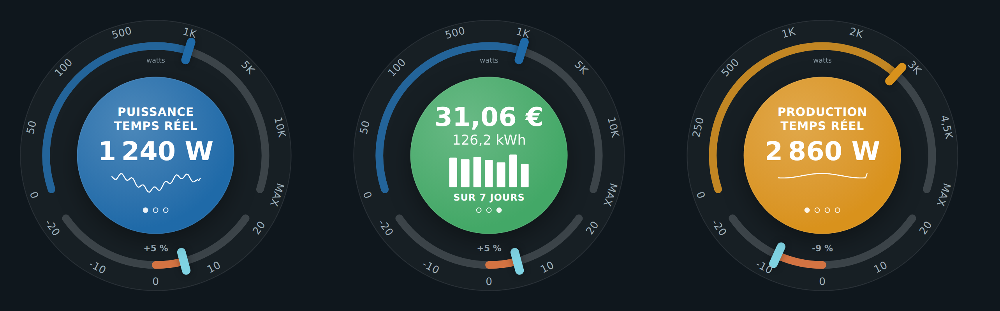
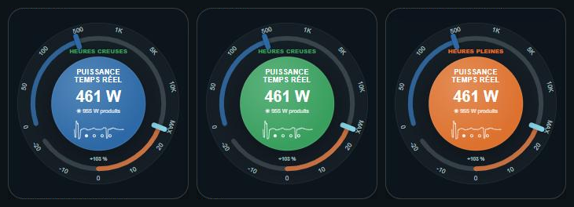
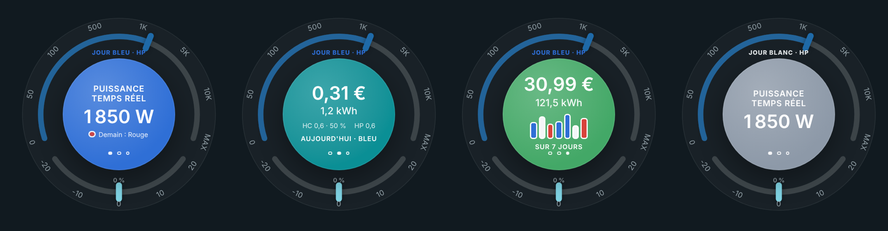

# ⚡ HOLM Ecojoko Card

[](https://hacs.xyz/)


**Le célèbre cadran de consommation, dans Home Assistant : la puissance en direct, le coût du jour, la semaine, et si vous consommez plus ou moins que d'habitude.**

HOLM Ecojoko Card reprend l'esprit du cadran Ecojoko : une grande jauge de puissance à échelle logarithmique, un disque central qui fait défiler plusieurs informations, et une petite jauge qui indique si **aujourd'hui vous consommez plus ou moins que d'habitude**. Elle fonctionne avec n'importe quel compteur (Ecojoko, Linky, pince ampèremétrique…) et a aussi un **mode production solaire**.

> ✨ **Aucun helper.** Les chiffres du jour et de la semaine viennent des statistiques de Home Assistant. Tout se règle dans l'éditeur visuel.

### En bref

- 🎯 **Puissance en temps réel** sur une jauge 0 → 10 kW (échelle réglable), avec la courbe de la dernière heure.
- 💶 **Aujourd'hui** : kWh et coût, avec vos prix heures creuses / heures pleines (nombres ou entités), et la part des heures creuses.
- 🌗 **Heures creuses / heures pleines** : « Heures creuses » ou « Heures pleines » sur le cadran, et/ou disque vert / orange — automatique avec [HOLM HP/HC](https://github.com/kaaribou/holm-tarif), ou d'après le compteur HC / HP qui avance.
- 🔵⚪🔴 **Option Tempo (EDF)** : les 6 index (Bleu, Blanc, Rouge × HC / HP) et leurs prix, « Jour Bleu · HC » sur le cadran, disque aux couleurs du jour, couleur de demain, et barres de la semaine colorées selon le jour.
- 🔢 **Tous les compteurs** : capteurs remis à zéro chaque jour (Ecojoko…) ou **index cumulés** (Linky, ZLinky…), reconnus automatiquement — sans sous-compteur journalier.
- 📊 **Sur 7 jours** : coût, kWh et barres par jour.
- ↕️ **Écart du jour** : comparaison avec la moyenne des 7 derniers jours **aux mêmes heures** (+5 %, −9 %…).
- ☀️ **Mode production solaire** : production en direct, du jour, de la semaine et autoconsommation, avec valorisation (prix autoconsommé / prix de revente).
- 🔄 Défilement automatique des informations (ou manuel), couleurs personnalisables, taille réglable.



**Heures creuses / heures pleines** : texte seul, texte et fond en heures creuses, texte et fond en heures pleines



**Option Tempo** : jour Bleu avec la couleur de demain, coût du jour, semaine aux couleurs Tempo, jour Blanc



---

## Installation

### Avec HACS (recommandé)

1. HACS → menu ⋮ → **Dépôts personnalisés**.
2. Ajoutez `https://github.com/kaaribou/holm-ecojoko-card`, catégorie **Tableau de bord** (*Dashboard / Plugin*).
3. Recherchez la carte → **Télécharger**.
4. Rechargez la page (Ctrl + F5).

### Manuellement

1. Copiez `dist/holm-ecojoko-card.js` dans `config/www/community/holm-ecojoko-card/`.
2. **Paramètres → Tableaux de bord → ⋮ → Ressources → Ajouter** : `/local/community/holm-ecojoko-card/holm-ecojoko-card.js`, type **Module JavaScript**.
3. Rechargez la page.

---

## Utilisation

```yaml
type: custom:holm-ecojoko-card
power: sensor.puissance_maison            # W, temps réel
energy_hc: sensor.energie_heures_creuses  # kWh (ou Wh), total_increasing
energy_hp: sensor.energie_heures_pleines
price_hc: 0.2068                          # ou une entité (input_number…)
price_hp: 0.27
```

**Index cumulés (Linky, ZLinky…)** : indiquez directement vos index HC et HP. La carte calcule la consommation du jour (valeur actuelle − valeur à minuit, lue dans les statistiques de Home Assistant) : pas besoin de créer des compteurs journaliers (*utility_meter*).

```yaml
type: custom:holm-ecojoko-card
power: sensor.linky_puissance_apparente
energy_hc: sensor.lixee_easf01            # index HC (Wh ou kWh)
energy_hp: sensor.lixee_easf02            # index HP
energy_counter: total                     # facultatif : reconnu automatiquement
price_hc: 0.2068
price_hp: 0.27
```

**Mode production solaire :**

```yaml
type: custom:holm-ecojoko-card
mode: solar
power: sensor.puissance_solaire
energy: sensor.production_solaire         # kWh
export_energy: sensor.energie_revendue    # kWh (optionnel)
price_self: 0.2516                        # valeur d'un kWh autoconsommé
price_export: 0.04                        # prix de revente
```

## Options

| Option | Description | Par défaut |
|---|---|---|
| `mode` | `conso` (consommation) ou `solar` (production) | `conso` |
| `power` | Puissance en temps réel, en W (**obligatoire**) | — |
| `energy_hc` / `energy_hp` | Énergie consommée en heures creuses / pleines (kWh ou Wh) : compteur du jour ou index cumulé | — |
| `hc_display` | Indicateur heures creuses / pleines : `text` (texte sur le cadran), `color` (disque vert / orange), `both`, `none` | `text` |
| `hc_pages` | Fond coloré sur la page `power` seulement ou sur `all` (toutes les pages) | `power` |
| `hc_source` | Entité qui indique les heures creuses (ex. `binary_sensor.heures_creuses`, tarif en cours du Linky) | automatique |
| `hc_values` | Valeurs de `hc_source` qui signifient « heures creuses » | `on, HC, HC.., heures creuses` |
| `energy_counter` | `auto`, `daily` (remis à zéro chaque jour) ou `total` (index cumulé) | `auto` |
| `price_hc` / `price_hp` | Prix du kWh HC / HP : nombre ou entité | — |
| `tariff` | Option tarifaire : `hchp` (heures creuses / pleines) ou `tempo` | `hchp` |
| `energy_bleu_hc` … `energy_rouge_hp` | Tempo : les 6 index (`bleu`, `blanc`, `rouge` × `hc`, `hp`) | — |
| `price_bleu_hc` … `price_rouge_hp` | Tempo : les 6 prix (nombre ou entité) | — |
| `tempo_color` / `tempo_color_tomorrow` | Tempo : couleur du jour et de demain | automatique |
| `solar_power` / `solar_energy` / `export_energy` | En mode conso : ajoute une page « solaire » | — |
| `energy` / `price_self` / `price_export` / `forecast` | Mode solaire : production (kWh), valeurs du kWh, prévision | — |
| `max_power` | Puissance maximale de la jauge (W) | `12000` (6000 en solaire) |
| `scale` | Graduations de la jauge | `0, 50, 100, 500, 1000, 5000, 10000` |
| `rotate_seconds` | Défilement automatique (0 = désactivé) | `10` |
| `title` / `title_position` | Titre, en haut ou en bas | — |
| `size` / `show_frame` | Taille du cadran, cadre de la carte | — |
| `colors` | Couleurs de chaque page (`power`, `today`, `week`, `solar`…), `hc` / `hp` pour l'indicateur, `bleu` / `blanc` / `rouge` pour Tempo | bleu / turquoise / vert / or, vert / orange |

### Heures creuses / heures pleines

La carte sait si vous êtes en heures creuses, sans réglage :

1. avec l'intégration **[HOLM HP/HC](https://github.com/kaaribou/holm-tarif)**, son capteur `binary_sensor.heures_creuses` est trouvé automatiquement ;
2. sinon, d'après vos compteurs `energy_hc` / `energy_hp` : celui qui avance indique la période en cours (l'indicateur apparaît dès la première hausse) ;
3. ou d'après l'entité de votre choix (`hc_source`), par exemple le tarif en cours donné par votre compteur Linky.

L'indicateur peut afficher « Heures creuses » / « Heures pleines » sur le cadran, colorer le disque en vert / orange (sur la page puissance ou sur toutes), ou les deux.

### Option Tempo

Pour l'option **Tempo** d'EDF, choisissez **Option tarifaire → Tempo** dans l'éditeur, puis indiquez vos 6 index (un Linky ou un ZLinky les fournit) et vos 6 prix.

```yaml
type: custom:holm-ecojoko-card
power: sensor.linky_sinsts
tariff: tempo
energy_bleu_hc: sensor.linky_easf01
energy_bleu_hp: sensor.linky_easf02
energy_blanc_hc: sensor.linky_easf03
energy_blanc_hp: sensor.linky_easf04
energy_rouge_hc: sensor.linky_easf05
energy_rouge_hp: sensor.linky_easf06
price_bleu_hc: 0.1296
price_bleu_hp: 0.1609
price_blanc_hc: 0.1486
price_blanc_hp: 0.1894
price_rouge_hc: 0.1568
price_rouge_hp: 0.7562
hc_display: both
```

- **Couleur du jour et de demain** : trouvées automatiquement avec l'intégration [RTE Tempo](https://github.com/hekmon/rtetempo) (ou tout capteur « tempo » dont l'état est Bleu / Blanc / Rouge). Sinon, choisissez l'entité (`tempo_color`, `tempo_color_tomorrow`) ; à défaut, la couleur est déduite de l'index qui avance.
- **Heures creuses** : comme en HC / HP (HOLM HP/HC, capteur « Heures creuses » de RTE Tempo, `hc_source` ou index qui avance) ; à défaut, 22 h – 6 h.
- Sur le cadran : « Jour Bleu · HC » et/ou disque aux couleurs du jour (`hc_display`) ; la couleur de demain s'affiche sur la page puissance dès qu'elle est connue.
- Le coût du jour et de la semaine est calculé index par index ; chaque barre de la semaine prend la couleur Tempo du jour.

> Les prix ci-dessus sont des exemples : reportez ceux de votre contrat.

## FAQ

| Problème | Solution |
|---|---|
| Pas de coût | Indiquez `price_hc` / `price_hp` (ou `price_self` / `price_export` en solaire). |
| « Aujourd'hui » affiche un total énorme | Vos capteurs sont des index cumulés : choisissez **Index cumulé** (`energy_counter: total`) si la détection automatique ne l'a pas reconnu. Les statistiques doivent être activées pour ces capteurs (`state_class: total_increasing`). |
| Pas d'écart du jour | Il faut au moins une journée complète d'historique sur les 7 derniers jours. |
| La nouvelle version ne s'affiche pas | Videz le cache (Ctrl + F5). |

> Carte indépendante, sans lien avec la société Ecojoko : elle s'inspire simplement de son cadran.

---

## Un petit merci ?

La carte vous plaît ? Vous pouvez m'offrir une bière 🍺

[](https://paypal.me/kaaribou)

---

## Licence

Code : licence **MIT** — © kaaribou. Voir le [CHANGELOG](CHANGELOG.md).

Fait partie de **HOLM — Home Orchestration & Living Management** : la gestion et l'orchestration intelligente de la maison.

Les autres projets : [Volets HOLM](https://github.com/kaaribou/volets-holm) · [Climat HOLM](https://github.com/kaaribou/climat-holm) · [Carburant HOLM](https://github.com/kaaribou/carburant-holm) · [Commandes à la maison HOLM](https://github.com/kaaribou/commandes-holm) · [HOLM LaMetric](https://github.com/kaaribou/lametric-holm) · [HOLM My Menu](https://github.com/kaaribou/holm-mymenu) · [HOLM Lektrico](https://github.com/kaaribou/lektrico-holm) · [HOLM Navbar Card](https://github.com/kaaribou/holm-navbar-card) · [HOLM Climate Card](https://github.com/kaaribou/climate-card-holm) · [HOLM Music Card](https://github.com/kaaribou/holm-music-card) · [HOLM Sentinel Card](https://github.com/kaaribou/holm-sentinel-card) · [HOLM Security Card](https://github.com/kaaribou/holm-security-card) · [HOLM Recordings Card](https://github.com/kaaribou/holm-recordings-card) · [HOLM Covers Card](https://github.com/kaaribou/holm-covers-card) · [HOLM Runtime Card](https://github.com/kaaribou/holm-runtime-card) · [HOLM Power Flow Card](https://github.com/kaaribou/holm-power-flow-card) · [HOLM Energy Cards](https://github.com/kaaribou/holm-energy-cards) · [HOLM Radiator Card](https://github.com/kaaribou/holm-radiator-card) · [HOLM Floor Card](https://github.com/kaaribou/holm-floor-card) · [HOLM Smoke Card](https://github.com/kaaribou/holm-smoke-card) · [HOLM BG Card](https://github.com/kaaribou/holm-bg-card).
